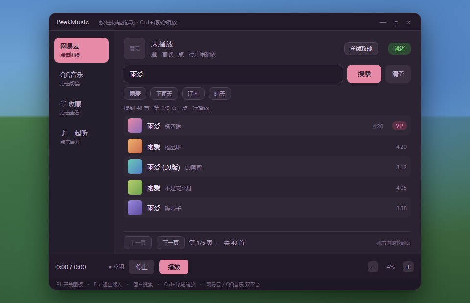
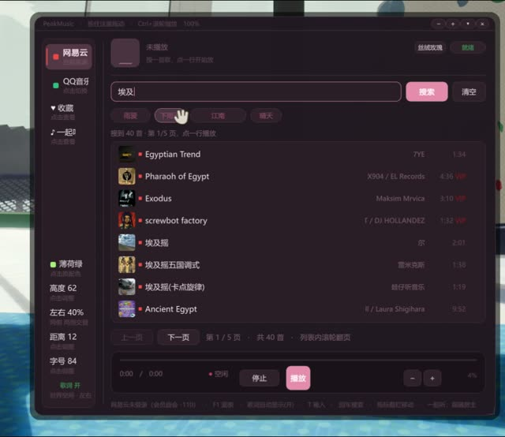
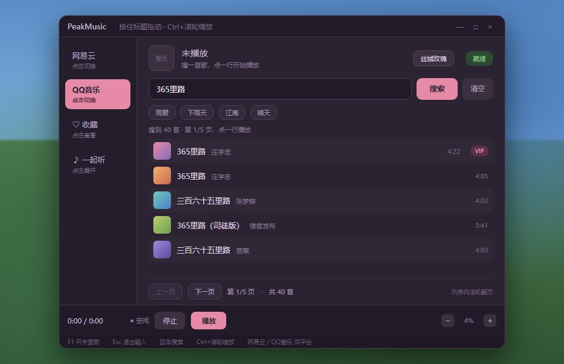
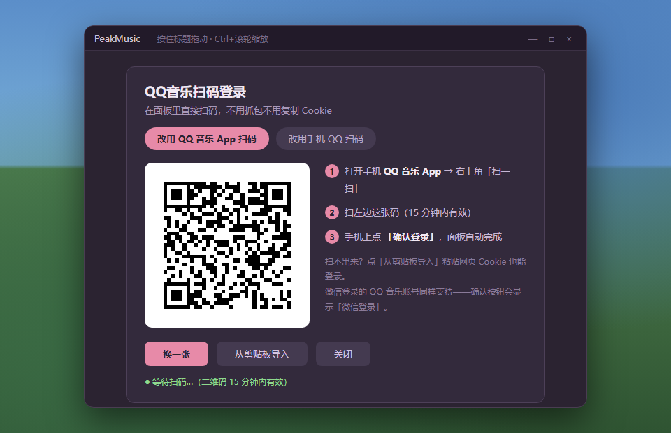
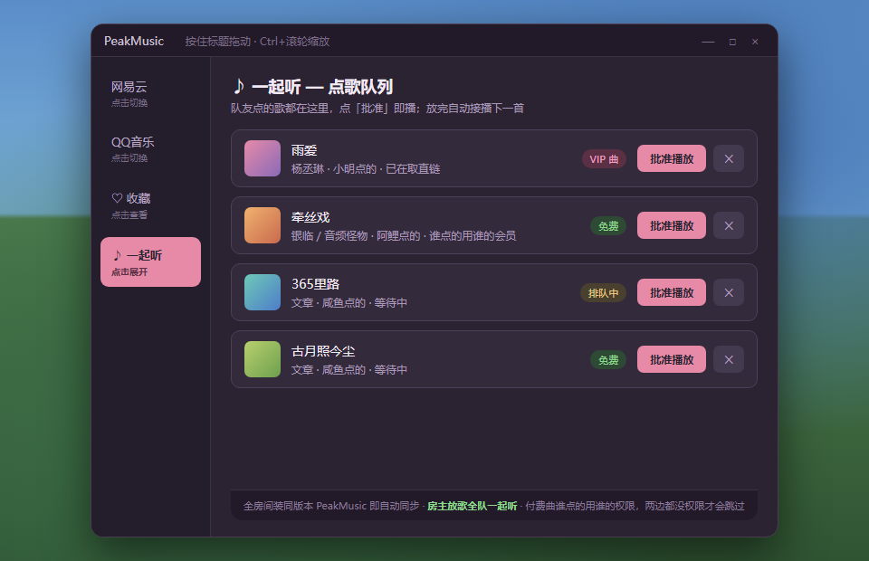

# PEAK Music Player（PeakMusic）

> 在 PEAK 游戏里听歌的 BepInEx 插件 —— 搜索网易云音乐 / QQ音乐直接放歌，会员账号能放会员曲，歌单与收藏同步，3D 悬浮歌词跟着视角走，联机「一起听」全房间同步，游戏内扫码登录。

爬山再累，也要有 BGM。按一下快捷键，搜索框敲歌名，点一行就播——不切窗口、不戴第二副耳机。


---

## 界面

默认是新版深色面板：左侧栏放平台切换、我的收藏、一起听和歌词设置，底部一张账号卡；主区是页头 + 搜索 + 歌曲列表 + 浮动播放条。

不喜欢或遇到问题，两种方式回到经典界面：

1. 打开 `BepInEx/config/peak.music.ui.cfg`，把 `NewPanel = false`，重进游戏；
2. 或者直接删掉 `BepInEx/plugins/PeakMusic/PeakMusic.UI.dll`。

两种方式都不影响搜索、播放、歌词和一起听 —— 新界面只换「画法」，不换「逻辑」。

---

## 功能

1. **搜索播放**：面板输入歌名/歌手/歌词关键词，点一行即播。网易云音乐、QQ音乐双平台可切换，搜索各查各的、结果分页浏览；免费曲不登录也能放。

2. **会员账号直接放会员曲**：用你自己账号的权限取流。面板底部实时显示登录态（已登录 · 黑胶VIP / 非会员 / 登录态已失效），会员曲能不能放一眼看清，不会「点了没反应」。

3. **歌单与收藏同步**：登录后同步你在客户端里的「我喜欢的音乐」和自建/收藏歌单，面板里直接翻歌单点播，不用每次重新搜。同步失败会在状态行说明原因，不静默失败。

4. **3D 悬浮歌词**：世界空间实时歌词，屏幕两侧交替浮现、逐字点亮，跟着视角走不挡准星。字号 / 高度 / 左右位置 / 离镜头距离 / 已唱·未唱·翻译三色 / 发光强度全部可调，有翻译时副行小字跟随；自动跳过「词：xxx 曲：xxx」这类制作信息行。默认开箱即用，放歌自动出现。

5. **联机一起听**：全房间装同版本即可用。房主放歌 → 全房间同步播放（进度 / 暂停 / 切歌）；队友在自己面板点歌 → 进房主的「♪ 一起听」队列（显示歌名+谁点的），房主点「批准」即播，放完自动接播下一首。

6. **谁点的歌用谁的会员**：点歌人先用自己的账号取播放直链随点歌发给房主，房主批准时直接播这条直链——房主没有会员也能放客机点的 VIP 曲；免费曲谁点都能放；两边都没权限的付费曲会明确提示原因，不装死。

7. **游戏内扫码登录**：面板里直接扫码（QQ 音乐 App / 手机 QQ 均可，微信登录的 QQ 音乐账号也支持），手机确认即完成，不用抓包不用复制 Cookie。网易云同样支持扫码。扫不出来还可以「从剪贴板导入」Cookie 兜底。

8. **面板随心调**：界面按屏幕高度自动放大（1080p 为基准，2K ≈ 1.33 倍、4K ≈ 2 倍），大屏上不会缩成一小块；标题栏拖动、Ctrl+滚轮缩放（0.7–1.8）、4 款主题配色（丝绒玫瑰 / 午夜石墨 / 极光海 / 曜石红）、折叠成迷你条、位置自动记忆。

---

## 截图展示

**主面板**（`F1` 打开）——搜索、结果列表、左侧歌词调节与平台切换：



中英文歌都能搜：



切到 QQ音乐标签，搜索只查 QQ 音乐：



**扫码登录卡片**——支持 QQ 音乐 App 扫码 / 手机 QQ 扫码两种方式：



**联机一起听队列**——队友点的歌在这里，点「批准」即播：



---

## 安装

**mod 管理器（推荐）**：搜 `PeakMusic` 安装即可，前置 BepInExPack_PEAK 会自动带上。

**手动安装**：

1. 先装 [BepInExPack_PEAK](https://thunderstore.io/c/peak/p/bepinex/BepInExPack_PEAK/)（5.4.75301）
2. 把压缩包里的 `plugins/PeakMusic` 文件夹复制到 `PEAK/BepInEx/plugins/` 下
3. 重启游戏，进游戏后按 `F1` 打开面板

---

## 使用方法

| 按键 | 功能 |
|---|---|
| `F1` | 打开/关闭面板（可在配置文件中改键，支持写多个备用键） |
| `F4` | 3D 歌词开/关（可在配置文件中改键） |
| 鼠标点击搜索框（或按 `T`） | 进入输入态打字，回车搜索 |
| 点结果列表某一行 | 播放这首歌 |
| `Esc` | 退出输入态（面板不关） |
| 标题栏拖动 / Ctrl+滚轮 | 移动面板 / 缩放面板 |

面板里可以：

- 切「网易云 / QQ音乐」标签换平台；「未登录」行点开扫码登录
- 左侧实时调节歌词：颜色（含薄荷绿等预设）、高度、左右位置、距离、字号
- 「♡ 收藏」查看收藏列表一键重播；搜索框下点最近搜索标签快速重搜
- 「♪ 一起听」查看队友点歌队列，批准 / 移出
- 右上角切换 4 款主题配色；面板可折叠成一条迷你标题栏

---

## 数据文件

```
%APPDATA%\PeakMusic\cookie.txt        网易云登录态（MUSIC_U / __csrf 等，完整保留）
%APPDATA%\PeakMusic\netease_device.txt 网易云设备号（os=pc / appver / deviceId，删掉会重新生成）
%APPDATA%\PeakMusic\qq_cookie.txt     QQ音乐登录态（qm_keyst / musickey 等）
%APPDATA%\PeakMusic\qq_guid.txt       QQ音乐取流设备号（删掉会重新生成）
%APPDATA%\PeakMusic\favorites.txt     收藏列表
%APPDATA%\PeakMusic\history.txt       最近搜索词
BepInEx\config\com.peakmusic.probe.cfg  全部配置
```

- 登录态只存在你自己电脑上，**不上传任何服务器**；删除文件即退出登录，随时可以自己检查内容
- 收藏 / 搜索历史 / 面板位置都是纯本地文本，重启游戏自动保留

---

## 配置项（`BepInEx/config/com.peakmusic.probe.cfg`）

| 配置 | 默认值 | 说明 |
|---|---|---|
| 界面 / PanelKey | `F1` | 面板开关热键，可写多个（如 `F1,F8`） |
| 界面 / Theme | 0 | 面板配色：0=丝绒玫瑰 1=午夜石墨 2=极光海 3=曜石红 |
| 界面 / PanelScale | 1 | 面板缩放倍率 0.7–1.8（在自动缩放基础上再乘，Ctrl+滚轮也能调） |
| 界面 / PanelCollapsed | false | 打开时是否折叠成迷你条 |
| 歌词 / Enabled | true | 3D 歌词总开关（放歌自动出现） |
| 歌词 / Hotkey | `F4` | 歌词开关键（别和 PanelKey 撞键） |
| 歌词 / Size | 84 | 歌词字号（屏幕像素高度，2K/4K 自动放大） |
| 歌词 / Y | 0.62 | 句子中心高度，0=屏幕顶 1=屏幕底 |
| 歌词 / Edge | 0.4 | 句子离屏幕边缘的远近 |
| 歌词 / Distance | 12 | 文字平面离镜头多远 |
| 歌词 / ColorLit | `A6F07A` | 已唱部分字色（十六进制，面板可切换预设） |
| 歌词 / Translation | true | 有翻译时显示副行 |
| 歌词 / FilterMeta | true | 跳过「词：xxx」等制作信息行 |
| 音源 / Platform | 0 | 当前音源：0=网易云 1=QQ音乐 |

改配置文件后需重启游戏；面板上直接点的都是立即生效。

---

## 实验功能：跟随本机播放器（默认关闭）

游戏外已经在客户端里放着歌，不想再在面板里搜一遍 —— 这个功能可以把「本机正在放什么」搬进游戏，屏幕顶部浮出一条歌词卡。

**默认关闭**（`peak.music.ui.cfg` 里 `Follow.AutoStart = false`）。原因是各家客户端的进度上报差异很大：

| 平台 | 情况 |
|---|---|
| QQ 音乐 | 有系统媒体时间轴，最准，推荐 |
| 酷狗 | 系统媒体只给歌名和状态、**不给进度**，进度靠推算（别拖进度条） |
| 网易云 | 新版客户端不上报系统媒体控制，**暂不支持** |

想试就把 `Follow.AutoStart` 改成 `true`，进游戏后在客户端放歌即可；`Follow.Hotkey`（默认 `F8`）切换 3D 歌词 / 顶部卡片，`Follow.LyricOffsetMs` 可手动微调偏移（一般不用动）。

---

## 工作原理（给在意安全性的玩家）

- **[开源透明](https://github.com/pht5740/PEAK-Music-Player)**：登录、取流、播放的每一行代码都可以在 GitHub 仓库审查，没有混淆、没有闭源组件
- **登录态只存本地**：扫码走的是网易云 / QQ音乐官方登录授权；拿到的 Cookie 只写进你本机的 `%APPDATA%\PeakMusic\` 文本文件，不经过任何第三方服务器
- **播放直连官方音源**：音频从网易云 / QQ音乐的官方 CDN 直接拉取，mod 不代理、不抓取、不存储音频文件
- **一起听只在房间内通信**：队列和播放同步走游戏联机通道（Photon），只同步歌名/曲号/进度这类必要信息；点歌人取的播放直链只发给同房间的房主
- **不改动游戏文件**：仅作为 BepInEx 插件加载，不修改任何游戏 DLL，删掉文件夹即彻底卸载

---

## 前置

- [BepInExPack_PEAK](https://thunderstore.io/c/peak/p/bepinex/BepInExPack_PEAK/) 5.4.75301（mod 管理器会自动安装）

---

## 常见问题

- **网易云有会员，却提示没会员 / 只放 30 秒**：先看面板底部账号行的状态——
  - 「网易云已登录 · 黑胶VIP」→ 服务器已认出会员，会员曲能正常取 320k；若个别歌仍失败，是那首无版权 / 有地区限制
  - 「网易云已登录 · 非会员」→ 这个账号确实没会员（或会员已过期），会员曲只能试听
  - 「网易云登录态已失效」→ cookie 过期，面板里退出后重新扫码
  - 「网易云未登录」→ 扫码登录
- **QQ 音乐提示取不到直链 / -110**：提示会直接说清是哪一类：
  - 「QQ音乐未登录」→ 面板里扫码登录再点
  - 「没认出登录态」→ 面板里退出登录，重新扫一次（App 扫码不行就换「手机 QQ 扫码」）
  - 「该账号下没有这首歌的播放权限」→ 服务器明确拒绝：这首要么无版权，要么需要更高等级会员
- **歌单同步失败**：面板状态行会显示接口返回码。常见是登录态过期（重新扫码）或该账号没有对应歌单权限。
- **一起听对面没声音**：确认两边装的是**同版本** PeakMusic（启动日志第一行版本号一致）、且在同一房间
- **歌词撞键失效**：`[歌词] Hotkey` 和面板键写成同一个键会自动失效，改开一个就行
- **改了设置没反应**：改 cfg 文件要重启游戏

---

## 致谢

- [BepInEx](https://github.com/BepInEx/BepInEx) —— 插件框架
- 感谢所有帮忙测试的朋友们
